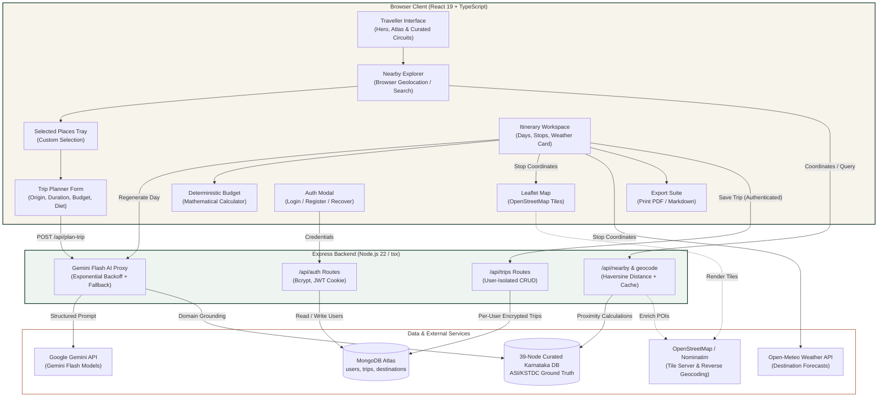

# Namma Yatra — ನಮ್ಮ ಯಾತ್ರೆ
### Your Karnataka. Your Journey.

**Hackathon:** NIE Karnataka Hackathon  
**Selected Problem Statement:** AI Travel Planner for Karnataka  
**Live Production Application:** [https://namma-yathra-platform.onrender.com/](https://namma-yathra-platform.onrender.com/)  
---

## 1. Project Introduction

**Namma Yatra (ನಮ್ಮ ಯಾತ್ರೆ)** is an editorial-grade, AI-assisted travel planning and circuit intelligence platform crafted specifically for Karnataka. Developed for the **NIE Karnataka Hackathon** under the **"AI Travel Planner for Karnataka"** track, the platform bridges modern artificial intelligence with authentic cultural, geographic, and culinary ground truth.

Karnataka spans 31 districts, 320 km of Arabian Sea coastline, the Western Ghats biodiversity hotspot, and thousands of protected monuments. Planning a journey across this expanse traditionally demands consulting dozens of disparate blogs, outdated transit charts, fragmented ticket fee structures, and unreliable weather summaries.

Namma Yatra transforms this experience into an intuitive, reliable journey planner. By combining **Google Gemini Flash** with a **curated 39-node Karnataka knowledge base** (32 scenic and heritage monuments plus 7 regional culinary heritage circuits), **OpenStreetMap** interactive mapping, **deterministic budget arithmetic**, live **Open-Meteo** destination climate forecasts, and **MongoDB Atlas** per-user cloud persistence, Namma Yatra produces actionable, geographically grounded travel itineraries in seconds.

---

## 2. Problem Statement

### Context & Regional Complexity
Karnataka presents an extraordinary blend of travel experiences:
- **Heritage & Royal History:** UNESCO World Heritage sites at Hampi and Pattadakal, Hoysala temples of Belur and Halebidu, cave shrines of Badami, and the royal heritage of Mysuru and Srirangapatna.
- **Nature & Western Ghats:** High-altitude coffee plantations and mist-covered ranges in Coorg, Chikkamagaluru, Kudremukh, and the Agumbe rainforest.
- **Coastal Karavali:** Pristine Arabian Sea shorelines across Gokarna, Udupi, Murudeshwar, and Karwar.
- **Culinary Diversity:** Distinct regional cuisines ranging from Mysore Masala Dosa and Udupi Satvik temple oota to Karavali seafood, Kodava hill dishes, and North Karnataka Jolada Rotti.

### The Traveller's Dilemma
Travellers routinely face significant friction when assembling multi-day journeys:
1. **Information Fragmentation:** Timings, ticket costs, dress codes, and seasonal suitability are scattered across dated forums and static government portals.
2. **Generic LLM Hallucinations:** Popular AI chatbots lack spatial awareness, frequently generating physically impossible transit plans (e.g., proposing lunch in Gokarna followed by an afternoon walking tour in Hampi, a 300+ km drive across ghat terrain).
3. **Fabricated Financials:** Generic tools invent arbitrary hotel room rates, ticket prices, and travel expenses without structured mathematical models.
4. **All-or-Nothing Regeneration:** Modifying a single destination often forces the traveller to regenerate the entire itinerary from scratch, discarding good plans.
5. **Bengaluru-Centric Assumptions:** Existing travel tools rigidly assume every Karnataka itinerary begins and ends in Bengaluru, ignoring residents and travellers arriving via Mangaluru, Hubballi-Dharwad, Belagavi, or Kalaburagi.
6. **No Session Persistence:** Itineraries disappear once browser sessions terminate, preventing travelers from retrieving saved plans across devices.

### Selected Hackathon Track
**AI Travel Planner for Karnataka:** Building an intelligent, culturally rooted, geographically sound travel planning platform that honors the state's living heritage while solving real travel logistics.

---

## 3. Proposed Solution

Namma Yatra addresses these challenges through a full-stack, domain-grounded architecture:

- **Domain-Grounded AI Generation:** Upstream prompts enforce strict geographic clustering, realistic transit intervals, authentic Kannada naming, and verified entry fees from certified ASI and Karnataka Tourism records.
- **Granular Itinerary Control:** Travellers can reorder stops, delete destinations with instant budget updates, or regenerate a single day using tailored natural-language prompts while keeping the rest of their trip intact.
- **Deterministic Budget Arithmetic:** Financial calculations are isolated from the creative AI model. A deterministic mathematical engine computes exact room counts, per-person daily food allocations, and admission fees with zero arithmetic hallucinations.
- **Nearby Places & Geolocation Discovery:** Travellers can detect their location via browser GPS or search across all 31 districts, filter by radius (10–150 km) and category, and stage custom places directly into a journey builder tray.
- **Zero-Dependency Interactive Mapping:** OpenStreetMap and Leaflet render interactive markers, route bounding, and synchronized card-to-map panning without expensive vendor lock-in.
- **Destination Climate Intelligence:** Real-time weather forecasts via Open-Meteo deliver temperature, conditions, and regional packing advisories per stop.
- **Secure Cloud Persistence:** Authenticated accounts backed by MongoDB Atlas safeguard saved itineraries with salted `bcryptjs` password hashing and signed HTTP-only JWT cookies.

---

## 4. Features: Implemented vs. Planned

### Implemented & Operational Features

| Feature | Operational Description |
| :--- | :--- |
| **AI-Assisted Itinerary Generation** | Synthesizes multi-day itineraries using Google Gemini Flash (`gemini-3.5-flash-lite` primary with exponential backoff and automated secondary fallbacks). Prompts are grounded in verified travel constraints and return structured JSON. |
| **Curated 39-Destination Knowledge Base** | 32 scenic and cultural landmarks plus 7 regional culinary heritage circuits with authentic Kannada script, ASI/KSTDC certified ticket fees, recommended visit durations, and regional specialties. |
| **Nearby Places Discovery Engine** | Browser GPS geolocation detection, radius slider (10 km to 150 km), text search, and category filtering (Heritage, Nature, Food, Temples, Beaches, Wildlife). |
| **Selected Places Builder Tray** | Staging tray allowing travellers to handpick custom destinations from the Atlas or nearby search and hand them off directly into the Trip Planner form. |
| **Interactive OpenStreetMap (Leaflet)** | Custom numbered map markers synchronized with the active day's itinerary stops, card-click auto-panning, and full-screen view without commercial map API costs. |
| **Single-Day Regeneration** | Allows travellers to refresh Day 2 or Day 3 with an optional prompt (e.g., *"Focus on waterfalls and nature"*) while keeping all other days unchanged. |
| **Interactive Stop Reordering & Deletion** | Reorder stops earlier or later in the day or remove unwanted stops; triggers an immediate client-side budget recalculation. |
| **Deterministic Financial Calculator** | Mathematical budget engine calculating exact room counts (`ceil(travellers / 2)`), daily food allowances based on travel style, summed monument entry tickets, and overrun warnings. |
| **Live Destination Weather & Advisories** | Open-Meteo integration querying exact stop coordinates for temperature, humidity, WMO condition codes, and regional packing advice (e.g., Western Ghats rain gear vs. northern plains sun protection). |
| **Secure Authentication & Cloud Sync** | User registration, login, and password recovery with `bcryptjs` salted password hashing, 7-day signed `HttpOnly, SameSite=Lax` cookies, and isolated per-user trip collections in MongoDB Atlas. |
| **Public Exploration with Gated Saving** | Guests can freely browse the Karnataka Atlas, discover nearby venues, and generate AI itineraries. Cloud saving and saved trip retrieval prompt seamless sign-in. |
| **Export & Offline Suite** | Print-ready PDF styling, clean Markdown download, and local browser offline storage (`localStorage`) for access in low-connectivity areas. |

### Planned Future Scope (Roadmap)

The following capabilities represent future enhancements and are not yet operational in the current release:
- **KSRTC & Indian Railways Real-Time Booking Deep-Links:** Integration with KSRTC bus schedules and South Western Railway train seat availability.
- **Turn-by-Turn Road Transit Navigation:** Vector map tile packages and road routing via Valhalla or OSRM for live driving directions.
- **Bidirectional Kannada / English UI Toggle:** Complete localized interface strings in native Kannada script alongside English.
- **Voice-Assisted Conversational Companion:** Speech-to-text input and natural voice guidance in Kannada and English for hands-free planning on the road.

---

## 5. Technology Stack

### Frontend
- **Framework & Language:** React 19, TypeScript
- **Build Tool:** Vite 8 (with Hot Module Replacement)
- **Styling:** Tailwind CSS v4, custom CSS design tokens
- **Animations & Icons:** Motion (`motion/react`), Lucide React
- **Mapping:** Leaflet & OpenStreetMap (vendor-free, zero-cost map tiles)

### Backend
- **Runtime & Server:** Node.js 22 (LTS), Express 4
- **TypeScript Execution:** `tsx` runtime for native TypeScript execution
- **Cookie Parsing:** `cookie-parser` for signed HTTP-only cookies

### AI & Intelligence
- **SDK:** `@google/genai` (Google Gen AI SDK v2.4+)
- **Primary Model:** `gemini-3.5-flash-lite` (low-latency primary, ~3-4s response)
- **Fallback Models:** `gemini-3.5-flash`, `gemini-3.6-flash`, followed by a deterministic Karnataka knowledge synthesizer
- **Resilience:** Bounded exponential backoff with jitter for transient 429 and 503 HTTP responses

### Database & Security
- **Database:** MongoDB Atlas (Official MongoDB Node.js Driver v7)
- **Testing Database:** `mongodb-memory-server` for isolated in-memory automated tests
- **Authentication:** `bcryptjs` (10 salt rounds) for password hashing, `jsonwebtoken` for secure session signing

### External APIs
- **Weather:** Open-Meteo REST API (free, open-access, zero-credential weather forecasts)
- **Geocoding:** OpenStreetMap Nominatim and Overpass API for reverse-geocoding and spatial discovery

### DevOps & Hosting
- **Hosting Platform:** Render (Web Service running Node 22)
- **Version Control:** Git & GitHub

---

## 6. System Architecture

The following diagram illustrates the verified data flow across the client, server, and external integrations:



> **Architectural Note on Routing:** OpenStreetMap and Leaflet provide client-side map rendering, numbered markers, and route bounding. Inter-stop distances are computed via the Haversine formula against verified Karnataka coordinates; turn-by-turn road navigation is planned for future releases.

---

## 7. Project Directory Structure

```
yatraai---karnataka-travel-planner/
├── .env.example                  # Template for required environment variables
├── .gitignore                    # Ignored files, dependencies, and build artifacts
├── index.html                    # Single-page HTML shell with Google Fonts & Leaflet CSS
├── package.json                  # Dependencies, scripts, and runtime engine specifications
├── render.yaml                   # Infrastructure-as-Code blueprint for Render deployment
├── server.ts                     # Main Express server, AI proxy, middleware, and Vite integration
├── tsconfig.json                 # TypeScript compiler configuration
├── vite.config.ts                # Vite build and plugin setup
│
├── public/                       # Static public assets
│   ├── images/                   # Curated, authentic Karnataka monument & culinary photos
│   └── favicon.ico               # Application favicon
│
├── src/                          # Frontend and backend application source
│   ├── App.tsx                   # Main React application controller, state management, and views
│   ├── main.tsx                  # React DOM entry point
│   ├── index.css                 # Global CSS design tokens, typography, and Leaflet overrides
│   │
│   ├── components/               # Modular React UI components
│   │   ├── AtlasInteractiveMap.tsx   # Statewide Karnataka Atlas exploration map
│   │   ├── AuthModal.tsx             # User registration, sign-in, and password reset modal
│   │   ├── BudgetBreakdown.tsx       # Deterministic budget calculator and formula display
│   │   ├── CuratedExperiences.tsx    # Showcase of regional heritage & culinary circuits
│   │   ├── CuratedShowcase.tsx       # Karnataka Atlas cards with filter chips
│   │   ├── DestinationWeatherCard.tsx # Open-Meteo destination weather forecast display
│   │   ├── EditorialFooter.tsx       # Editorial footer with attribution and links
│   │   ├── EditorialHero.tsx         # Hero banner with Kannada typography and CTAs
│   │   ├── ExportModal.tsx           # Printable PDF preview, Markdown export, and copy suite
│   │   ├── InteractiveMap.tsx        # Leaflet itinerary map with synchronized pins
│   │   ├── ItineraryWorkspace.tsx    # Daily timeline, stop cards, reorder controls, weather
│   │   ├── NearbyExplorer.tsx        # Geolocation search, radius filter, and place discovery
│   │   ├── SafeImage.tsx             # Image component with error handling and fallback
│   │   ├── SavedTripsModal.tsx       # User's saved journeys drawer with load/delete controls
│   │   ├── SelectedPlacesPanel.tsx   # Staging drawer for custom selected destinations
│   │   └── TripPlannerForm.tsx       # Intake form for origin, budget, pace, duration, diet
│   │
│   ├── data/                     # Verified static datasets
│   │   └── destinations.ts       # 39 curated destinations (32 landmarks + 7 food circuits)
│   │
│   ├── server/                   # Backend modular services and routes
│   │   ├── authRoutes.ts         # Authentication handlers (register, login, logout, me, reset)
│   │   ├── db.ts                 # MongoDB Atlas connection manager and collection getters
│   │   ├── nearbyRoutes.ts       # Geocoding, reverse geocoding, and radius search endpoints
│   │   └── tripRoutes.ts         # User-isolated trip CRUD and database status endpoints
│   │
│   ├── services/                 # Client-side API abstraction services
│   │   ├── authService.ts        # Client calls for user sessions and authentication
│   │   ├── nearbyService.ts      # Client calls for geolocation and nearby discovery
│   │   ├── tripStorageService.ts # Client calls for MongoDB Atlas trip persistence
│   │   └── weatherService.ts     # Open-Meteo client service with 30-min cache and advisories
│   │
│   └── types/                    # TypeScript interfaces and domain schemas
│       └── itinerary.ts          # Itinerary, destination, budget, user, and weather types
│
├── tests/                        # Automated QA and integration test suites
│   ├── qa_verification_suite.ts  # 383+ tests for schemas, images, hydration, and deduplication
│   ├── test_mongodb_crud.ts      # 16 tests for MongoDB Atlas auth, isolation, and persistence
│   └── test_gemini_resilience.ts # 17 tests for Gemini AI latency, schemas, and retry logic
│
└── PRESENTATION_AND_DEMO_SCRIPT.md # Presentation slides outline and screencast video script
```

---

## 8. Prerequisites

To run the application locally, ensure you have:
1. **Node.js:** Version `20.0.0` or higher (Node `22.x LTS` recommended).
2. **npm:** Version `10.0.0` or higher.
3. **Google Gemini API Key:** An active API key from [Google AI Studio](https://aistudio.google.com/).
4. **MongoDB Atlas Database (Optional for Local Guest Mode):** A free-tier MongoDB Atlas connection string. If omitted, the application runs gracefully in standby mode with local in-browser storage.
5. **Modern Web Browser:** Chrome, Firefox, Edge, or Safari with JavaScript enabled.

---

## 9. Installation and Local Setup

Follow these steps to run Namma Yatra on your local machine:

### 1. Clone the Repository
```bash
git clone https://github.com/vishalvivek14332-source/Namma-Yathra-Platform.git
cd Namma-Yathra-Platform
```

### 2. Install Dependencies
```bash
npm install
```

### 3. Configure Environment Variables
Copy the sample environment file to create your local `.env`:
```bash
cp .env.example .env
```
Open `.env` in your text editor and supply your keys:
```env
# Required: Google Gemini AI Key
GEMINI_API_KEY="your-google-ai-studio-gemini-key"

# Optional: MongoDB Atlas URI (enables cloud persistence & auth)
MONGODB_URI="mongodb+srv://<username>:<password>@<cluster>.mongodb.net/?retryWrites=true&w=majority"
MONGODB_DB_NAME="YatraAI"

# Optional: JWT Secret for signing session cookies
JWT_SECRET="your-secure-random-jwt-secret"

# Optional: Server port (defaults to 3000)
PORT=3000
```

### 4. Run Automated Test Suites
Verify codebase integrity before starting the server:
```bash
# Run the QA verification test suite (383+ tests)
npm run test:qa

# Run the MongoDB Atlas & Authentication integration tests (16 tests)
npm run test:db

# Run the Gemini AI resilience & retry suite (17 tests)
npm run test:ai

# Run TypeScript type check
npm run lint
```

### 5. Start the Development Server
```bash
npm run dev
```
The unified development server (Express serving Vite middlewares with HMR) will start:
```
Server running at http://localhost:3000
Connected to MongoDB Atlas (YatraAI)
```
Open your browser and navigate to `http://localhost:3000`.

### 6. Building and Running for Production Locally
To validate the production bundle:
```bash
npm run build
npm start
```

---

## 10. Environment Variables

All sensitive credentials reside exclusively on the server. **No API keys or database connection strings are exposed to the client bundle.**

| Variable Name | Environment | Required | Default / Description |
| :--- | :--- | :--- | :--- |
| `GEMINI_API_KEY` | Server-side | **Yes** | API key from Google AI Studio. Used by the backend AI proxy. |
| `MONGODB_URI` | Server-side | Optional | Connection string for MongoDB Atlas. If absent, database operates in standby mode. |
| `MONGODB_DB_NAME` | Server-side | Optional | Database name in MongoDB Atlas. Defaults to `YatraAI`. |
| `JWT_SECRET` | Server-side | Optional | Secret key for signing session tokens in HTTP-only cookies. |
| `PORT` | Server-side | Optional | Server port. Defaults to `3000` (assigned dynamically on Render). |
| `NODE_ENV` | Server-side | Optional | Runtime mode: `development` or `production`. |
| `APP_URL` | Server-side | Optional | Base application URL (e.g., `http://localhost:3000`). |

> **Security Rule:** Never prefix backend secrets with `VITE_`. Frontend files must never reference `process.env.GEMINI_API_KEY` or `process.env.MONGODB_URI`.

---

## 11. API Documentation

The Express server exposes the following REST API endpoints:

### Core Planning & Generation Endpoints
| Method | Endpoint | Purpose | Request Body / Parameters | Response Behavior |
| :--- | :--- | :--- | :--- | :--- |
| `POST` | `/api/plan-trip` | Generates a complete multi-day itinerary using Gemini Flash. | JSON containing `origin`, `durationDays`, `travellersCount`, `budgetStyle`, `travelPace`, `dietaryPreferences`, `selectedPlaces`. | `200 OK` with structured `TripItinerary` object; fallback synthesis if AI rate-limited. |
| `POST` | `/api/regenerate-day` | Refreshes a single day's stops without altering other days. | JSON containing `currentTrip`, `dayNumber`, optional `customPrompt`. | `200 OK` with updated single-day stops and travel notes. |

### Destination Discovery & Geocoding Endpoints
| Method | Endpoint | Purpose | Request Body / Parameters | Response Behavior |
| :--- | :--- | :--- | :--- | :--- |
| `GET` | `/api/destinations` | Returns verified 39-node Karnataka catalog. | None. | `200 OK` with destination records and metadata. |
| `GET` | `/api/nearby` | Finds attractions within a radius of given coordinates. | Query params: `lat`, `lng`, `radiusKm` (10-150), `category`, `allKarnataka`. | `200 OK` with list of categorized, distance-sorted attractions. |
| `GET` | `/api/geocode` | Autocompletes Karnataka cities, towns, and hubs. | Query param: `q` (search string). | `200 OK` with suggestions matching curated hubs or destinations. |
| `GET` | `/api/reverse-geocode` | Resolves geographic coordinates to a Karnataka locality. | Query params: `lat`, `lng`. | `200 OK` with localized name, district, and display string. |

### Authentication Endpoints (`/api/auth`)
| Method | Endpoint | Purpose | Request Body / Parameters | Response Behavior |
| :--- | :--- | :--- | :--- | :--- |
| `POST` | `/api/auth/register` | Registers a new user account. | JSON: `email`, `password`, `fullName`. | `201 Created` with user profile; sets HTTP-only session cookie. |
| `POST` | `/api/auth/login` | Authenticates existing user. | JSON: `email`, `password`. | `200 OK` with user profile; sets HTTP-only session cookie. |
| `POST` | `/api/auth/logout` | Ends user session. | None (reads cookie). | `200 OK`; clears `namma_yatra_token` cookie. |
| `GET` | `/api/auth/me` | Returns profile of currently authenticated user. | None (reads cookie). | `200 OK` with user profile, or `{ success: true, user: null }` if guest. |
| `POST` | `/api/auth/forgot-password` | Generates password recovery token. | JSON: `email`. | `200 OK` with confirmation message. |
| `POST` | `/api/auth/reset-password` | Resets password using single-use token. | JSON: `token`, `newPassword`. | `200 OK` with success status. |

### Trip Storage Endpoints (`/api/trips`)
| Method | Endpoint | Purpose | Request Body / Parameters | Response Behavior |
| :--- | :--- | :--- | :--- | :--- |
| `POST` | `/api/trips` | Saves a new itinerary to MongoDB Atlas. | JSON: Complete `TripItinerary` document. *(Requires Auth)* | `201 Created` with saved trip ID. |
| `GET` | `/api/trips` | Retrieves all saved trips for the authenticated user. | Optional query param: `?search=...`. *(Requires Auth)* | `200 OK` with user's saved trips. |
| `GET` | `/api/trips/:id` | Retrieves a specific trip by MongoDB ObjectId. | Route param: `:id`. *(Requires Auth)* | `200 OK` with trip details; strictly isolated by user ID. |
| `PUT` | `/api/trips/:id` | Updates an existing trip's notes, stops, or title. | Route param: `:id`, JSON body with updates. *(Requires Auth)* | `200 OK` with updated trip document. |
| `DELETE` | `/api/trips/:id` | Deletes a saved trip from the database. | Route param: `:id`. *(Requires Auth)* | `200 OK` with deletion confirmation. |

### Health & Monitoring Endpoints
| Method | Endpoint | Purpose | Request Body / Parameters | Response Behavior |
| :--- | :--- | :--- | :--- | :--- |
| `GET` | `/healthz` | Platform health check probe for Render. | None. | `200 OK` with status and server uptime. |
| `GET` | `/api/db/status` | Reports MongoDB Atlas connectivity health. | None. | `200 OK` with connection state, collection counts, and diagnostics. |

---

## 12. Deployment

Namma Yatra is continuously deployed to **Render** as a Node.js Web Service.

- **Live URL:** [https://namma-yathra-platform.onrender.com/](https://namma-yathra-platform.onrender.com/)
- **Infrastructure Blueprint:** Pre-configured via [`render.yaml`](render.yaml).

### Manual Configuration on Render Dashboard
If configuring the service manually rather than via the Render Blueprint:
1. **Service Type:** Web Service
2. **Environment:** Node
3. **Node Version:** `22` (specified via `NODE_VERSION=22` or `engines.node` in `package.json`)
4. **Build Command:** `npm install && npm run build` (or `npm run render-build`)
5. **Start Command:** `npm start`
6. **Health Check Path:** `/healthz`
7. **Environment Variables:**
   - `NODE_ENV`: `production`
   - `GEMINI_API_KEY`: *(Your private Google AI Studio key)*
   - `MONGODB_URI`: *(Your MongoDB Atlas connection URI)*
   - `MONGODB_DB_NAME`: `YatraAI`
   - `JWT_SECRET`: *(A long, cryptographically random secret string)*

### Deployment Troubleshooting

#### 1. Missing Frontend Static Bundle (`ENOENT: .../dist/index.html`)
- **Cause:** Render's default build command is `npm install`, which skips compiling the Vite frontend.
- **Resolution:** Set the **Build Command** to `npm install && npm run build`. The server checks for `dist/index.html` at startup and logs diagnostic guidance if missing.

#### 2. MongoDB Atlas TLS Handshake Alert (`ssl3_read_bytes:tlsv1 alert internal error`)
- **Cause:** Render uses dynamic outbound IP addresses. If the MongoDB Atlas Network Access whitelist does not allow incoming traffic from dynamic cloud IPs, connections are dropped during TLS handshakes.
- **Resolution:**
  1. Open the [MongoDB Atlas Dashboard](https://cloud.mongodb.com/).
  2. Navigate to **Security** → **Network Access**.
  3. Click **Add IP Address** and select **Allow Access from Anywhere** (`0.0.0.0/0`).
  4. Confirm changes. Within 1–2 minutes, `/api/db/status` will report `connected: true`.

---

## 13. Testing and Troubleshooting

### Test Suites
The project includes three automated test suites ensuring reliability across all layers:

```bash
# 1. QA Verification Suite (383+ tests)
npm run test:qa
```
- Validates all 39 destinations for valid coordinates, authentic photo links, CC/Wikimedia attribution metadata, category matching, and deduplication logic.

```bash
# 2. MongoDB Atlas & Authentication Suite (16 tests)
npm run test:db
```
- Executes an in-memory MongoDB server to verify user registration, duplicate email rejection (`409 Conflict`), password hashing, JWT session cookies, and strict per-user trip data isolation.

```bash
# 3. Gemini AI Resilience Suite (17 tests)
npm run test:ai
```
- Benchmarks latency on `gemini-3.5-flash-lite`, validates strict JSON output compliance, verifies transient error retries (429, 503), and ensures graceful offline fallback synthesis.

```bash
# 4. TypeScript Type Checking
npm run lint
```
- Runs `tsc --noEmit` to ensure strict type compliance across frontend and backend code.

### Common Troubleshooting Scenarios

| Issue | Root Cause | Solution |
| :--- | :--- | :--- |
| **Server warns: `GEMINI_API_KEY is not set`** | Missing `.env` file or undefined key. | Create `.env` and add a valid key from Google AI Studio. The server will use verified fallback synthesis in the meantime. |
| **Database reports `Standby Mode`** | `MONGODB_URI` is not configured. | Normal for guest browsing. Add `MONGODB_URI` to `.env` to enable user accounts and cloud trip saving. |
| **Port 3000 already in use** | Another local process is listening on port 3000. | Start on a different port: `PORT=3001 npm run dev`. |
| **Geolocation access denied in browser** | Browser location permissions blocked. | Search for your starting city or landmark manually in the search bar. |

---

## 14. Future Improvements (Roadmap)

The following roadmap items represent planned future enhancements for Namma Yatra:

1. **Public Transit & Transport APIs:**
   - Direct integration with KSRTC bus route schedules and South Western Railway train availability for door-to-door transit planning.
2. **Turn-by-Turn Road Transit Engine:**
   - Integration with open routing engines (Valhalla / OSRM) for accurate road travel times, toll estimations, and ghat-road warnings.
3. **Full Bidirectional Kannada Localization:**
   - Complete bilingual UI with a native Kannada (ಕನ್ನಡ) interface toggle.
4. **Conversational Kannada Voice Companion:**
   - Hands-free, voice-activated travel assistant delivering contextual monument trivia and local navigation advice in Kannada and English.
5. **KSTDC Certified Tour Guide Booking:**
   - Deep-linking with certified Karnataka tourism guides and local heritage walk organizers at Hampi, Badami, and Belur.

---

## 15. Project Conclusion

**Namma Yatra (ನಮ್ಮ ಯಾತ್ರೆ)** demonstrates how domain-specific AI, when grounded in authentic cultural and geographic reality, can solve practical travel challenges for Karnataka's tourism ecosystem. By eliminating AI hallucinations, providing deterministic financial clarity, offering granular single-day editing, and highlighting local culinary heritage alongside UNESCO monuments, Namma Yatra delivers a dependable, respectful, and delightful travel planning experience.

Developed with pride for the **NIE Karnataka Hackathon**.  
**Jai Karnataka! ಸಿರಿಗನ್ನಡಂ ಗೆಲ್ಗೆ, ಸಿರಿಗನ್ನಡಂ ಬಾಳ್ಗೆ!**

---

## 16. License

This project is licensed under the [Apache-2.0 License](LICENSE).  
Monument information, historic details, and coordinates are verified against records from the Archaeological Survey of India (ASI) and Karnataka State Tourism Development Corporation (KSTDC).
